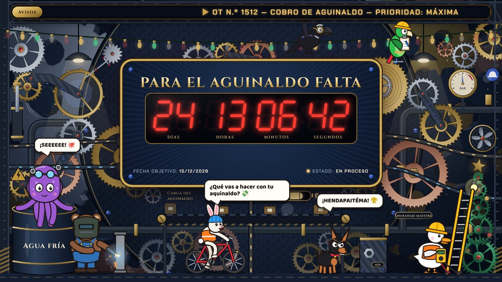

# ⚙️ Para el aguinaldo falta…

**Panel animado de cuenta regresiva al cobro del aguinaldo, hecho para proyectar en la TV del taller de mantenimiento.**

**[Ver en vivo →](https://cuenta-regresiva-aguinaldo.pages.dev)**



Un reloj de 7 segmentos montado sobre una maquinaria estilo relojería suiza que funciona de verdad (engranajes que engranan, volante, rueda de escape, cables con corriente), un fondo 3D y **10 personajes** con personalidad propia que hacen mantenimiento, se pelean, se piden plata prestada «hasta que cobre el aguinaldo» y se preguntan en qué lo van a gastar (*hendapaitéma*). Cada tanto el reloj **se rompe**, todos ayudan a repararlo y alguien lo **calibra** con la hora real. El 15 de diciembre, fiesta.

| | |
|---|---|
| **Stack** | HTML + CSS + JavaScript sin frameworks · SVG animado · Three.js (fondo 3D) · esbuild |
| **Hosting** | Cloudflare Pages, desplegado automáticamente desde GitHub |
| **Rendimiento** | Pensado para TVs: piezas animadas en capas de GPU, 3D a resolución reducida y modo liviano automático |
| **Seguridad** | Sitio 100 % estático, sin terceros, CSP estricta y cabeceras de seguridad ([SECURITY.md](SECURITY.md)) |
| **Idioma** | Español de Paraguay, con refranes (ñe'ẽnga) en guaraní |

## Detalle del proyecto

Estética "calibre nocturno" de relojería suiza: platina con perlado, puentes de rodio con Côtes de Genève, ruedas de oro y acero esqueletadas, rubíes, volante con espiral y rueda de escape que avanza un diente por segundo.

Panel online que muestra **PARA EL AGUINALDO FALTA _días · horas · minutos · segundos_** hasta el cobro del aguinaldo
(**15/12/2026, 00:00 hora de Paraguay**), con un taller animado de fondo y 8 animales trabajando.

## Qué tiene
- **Reloj digital de 7 segmentos** dentro de un panel de chapa con remaches y franjas de seguridad.
- **Maquinaria funcionando detrás**: engranajes que engranan de verdad, cables con corriente, caños de cobre,
  manómetro, pistón, vapor, luces navideñas y un arbolito hecho de engranajes.
- **Fondo 3D (Three.js)**: engranajes metálicos girando, caños, nieve y luces bokeh.
- **10 personajes con 6 animaciones cada uno** que van apareciendo de a poco (a veces varios a la vez):
  | Personaje | Acciones |
  |---|---|
  | Oso soldador | suelda, se seca el sudor, martilla, toma tereré, baila, mira el reloj |
  | Don Anó (pájaro sabio) | aconseja con ñe’ẽnga en guaraní y castellano, piensa, lee su libro de refranes, controla cableado, vuela a aconsejar a cada compañero |
  | Pulpo | multitarea con 4 herramientas, gira válvula, tira tinta, checklist, malabares, saluda |
  | Conejo en bici | pedalea, genera energía, hace willy, toca timbre, pinchadura, se cansa |
  | Pato con casco | levanta la escalera, sube, cambia la lámpara, tambalea, mide tensión, festeja |
  | Pinscher rabioso | pelea con el bulón, ladra, patea, tira la llave, tiembla, ¡lo saca! |
  | Chanchito navideño | aceita engranajes, se resbala, come chipa, golpea el manómetro, barre, sueña |
  | Ratón con casco | linterna, corre en la rueda, carga un bulón, carga la OT, espía, saluda — y **roba repuestos** recorriendo el panel y el piso |
  | Mono travieso | come banana, toca batería, mortal hacia atrás, golpe de pecho, malabares, selfie — salta por toda la pantalla |
  | Loro con casco | habla, supervisa con planilla, radio, silba, baila, duerme la siesta |
- **El anó y el loro vuelan por toda la pantalla** (luces, lámpara, manómetro, arbolito, panel).
- **Escenas entre animales**: el pinscher se pelea con el anó · el ratón le roba la chipa al chanchito · el ratón le roba la llave al pinscher · el ratón se roba la estrella del arbolito · el loro imita al pinscher · el oso le convida tereré al conejo.
- **Trabajos de mantenimiento**: el oso repara el motor, el mono cambia rodamientos, el ratón ajusta sensores, el anó controla el cableado, el chanchito limpia filtros, el pulpo suelda placas, el conejo reparte repuestos, el pinscher da torque, el loro bloquea y etiqueta, y el pato… hace lo que puede (se tropieza, pinta de más y se enreda).
- **Mantenimientos programados en pareja**: el reloj se pausa sin alarma y al final alguien lo calibra.
- **Paradas del reloj** (cada 3–4 min): el ratón roba el perno del engranaje maestro, el anó provoca un apagón o el pinscher traba los engranajes con la llave. El reloj se congela, suenan las balizas y todos ayudan a repararlo; al final alguien **calibra el reloj** con la hora oficial (los dígitos giran hasta la hora real).
- **Batería “Nivel de carga del aguinaldo”** (avance del año hasta la fecha objetivo).
- **Cartel LED** con avisos del taller.
- Al llegar a cero: **“¡LLEGÓ EL AGUINALDO!”**, fiesta de todos los personajes, confeti y billetes.

## Parámetros de URL
- `?fecha=2026-12-15T08:00` → cambia la fecha/hora objetivo (hora de Paraguay).
- `?demo=20` → prueba: la cuenta llega a cero en 20 segundos.
- `?escena=0` … `?escena=37` (26–31: chistes del caso Ueno; 32–37: «¿qué vas a hacer con tu aguinaldo?» y hendapaitéma) (15–17: préstamos "hasta que cobre el aguinaldo"; 18–25: trabajos en pareja) → muestra una escena entre animales puntual.
- `?parada=0` … `?parada=2` → muestra una parada puntual (perno robado, apagón, atasco).
- `?clima=lluvia` (o `llovizna`, `tormenta`, `granizo`, `calor`, `frio`, `nublado`, `sol`, `niebla`) y `?temp=38` → fuerzan un clima para probar. Sin ese parámetro, el panel lee el **clima real de Asunción** cada 10 minutos ([Open-Meteo](https://open-meteo.com), gratuito y sin clave): con lluvia aparecen la lluvia, las goteras y los baldes; con tormenta, relámpagos; con calor, sol y frases de calor. Escenas de clima: `?escena=38` … `?escena=47`.
- `?lite` → fuerza el modo liviano (para TVs o PCs modestas). Igual se activa solo si la pantalla no llega a 45 cuadros por segundo.
- `?hd` → fuerza la calidad completa y desactiva el ajuste automático.

## Desarrollo y despliegue (Cloudflare Workers – Static Assets)
```bash
npm install
npm run dev      # compila el fondo 3D y levanta wrangler dev
npm run deploy   # compila y publica en Cloudflare
```
El sitio es 100 % estático (`public/`). `public/js/scene3d.bundle.js` se genera desde `src/scene3d.js`
con esbuild y está versionado, así Cloudflare puede publicar sin paso de build.

## Licencia

[MIT](LICENSE) © 2026 Germán Domínguez. Personajes, ilustraciones y textos son originales del proyecto.
